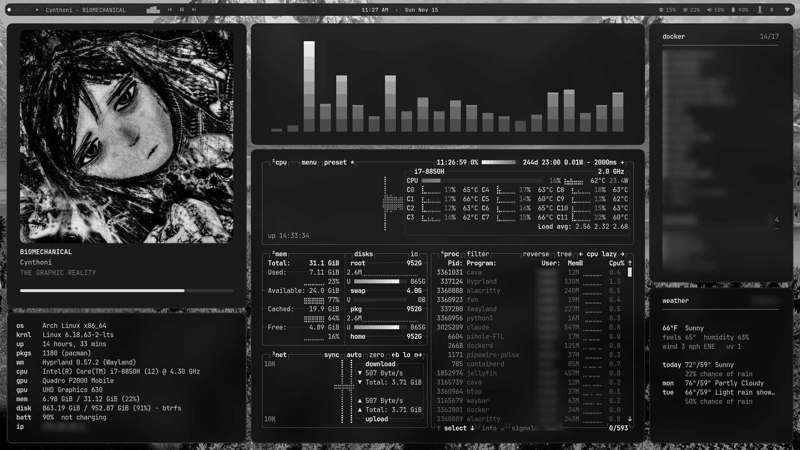
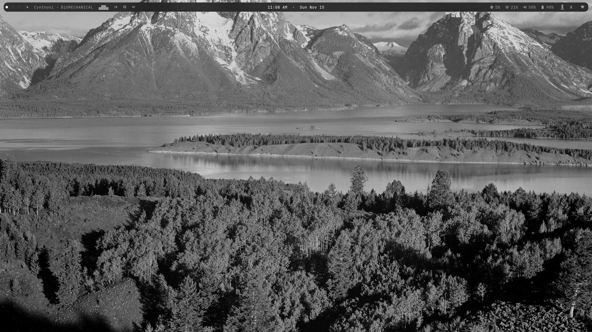

# Grayscale Hyprland rice

Monochrome Hyprland setup: waybar, a boot splash and dashboard on workspace 1
(album art, cava visualizer, btop, weather, fastfetch), rounded windows with blur,
and a lock screen to match.

The dashboard on workspace 1 (`Super+Shift+D` toggles it). In the screenshot some private bits are blurred (the Docker/Tailscale lists, weather city, IP and the user column).

| Section | What it is |
|---|---|
| **Top bar** (waybar) | Workspace dots, now-playing with a tiny visualizer and prev / play-pause / next, the clock in the middle; CPU, memory, volume, battery, tray, chess button, Bluetooth and Wi-Fi on the right. |
| **Album art** (top left) | Grayscale cover with rounded corners, title / artist / album and a progress bar. Covers are cached in `~/.cache/dash-art/`. |
| **Fetch** (bottom left) | fastfetch: OS, kernel, uptime, packages, WM, CPU, GPU, memory, disk, battery and a hidden IP (`Super+Shift+I` reveals it). |
| **Visualizer** (top middle) | Live cava-style audio bars. |
| **btop** (middle) | CPU, memory, disks, network and the process list. |
| **Services** (top right) | Docker containers and Tailscale devices; shows `n/a` if you don't run them. |
| **Weather** (bottom right) | Current weather and a 3-day forecast from wttr.in, located by IP. |

## Pop-ups

All of these are small floating terminal apps in the same grayscale look. Press the key again to close them.

| Key | What it opens |
|---|---|
| `Super+F1` | Cheatsheet with every keybind (`q`, `Esc`, `Enter` or `Space` closes it) |
| `Super+N` | Wi-Fi manager: pick a network, connect, forget, join a hidden one (also: click the Wi-Fi icon in the bar) |
| `Super+A` | Audio: choose the output / input device and set its volume (also: click the volume in the bar; right-click mutes) |
| `Super+B` | Bluetooth manager (`bluetui`) |
| `Super+Shift+B` | Replay the boot splash and rebuild the dashboard (extra presses are ignored while it runs) |

Other details: the cursor hides after 1 s of inactivity; the album-art pane downloads covers in the background and
shows a "loading cover..." placeholder (covers are cached in `~/.cache/dash-art/`); Hyprland's log is kept in
`~/.cache/hyprland-last.log` so a crash right after resume can be diagnosed after a reboot.

Plain desktop without the dashboard:

**Needs Hyprland 0.57 or newer** (the config is `hyprland.lua`). Written for Arch.

    git clone <this repo> && cd dotfiles && ./install.sh

The installer backs up any config it replaces. After logging in, `Super+F1` shows every keybind.

Notes
- The dashboard's Docker and Tailscale panes just show `n/a` if you don't run them.
- Spotify is autostarted on workspace 9 (`spotify-launcher`) and `Super+M` opens `spotify_player`;
  delete those lines in `config/hypr/hyprland.lua` if you don't use them.
- The wallpaper is `wall.jpg`; replace `~/Pictures/wall.jpg` with your own and the lock screen follows.
- Cava shader files keep their original authors' license headers.
